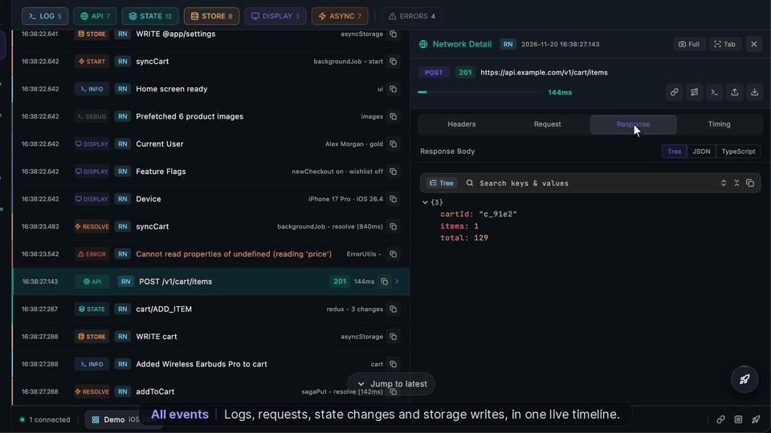
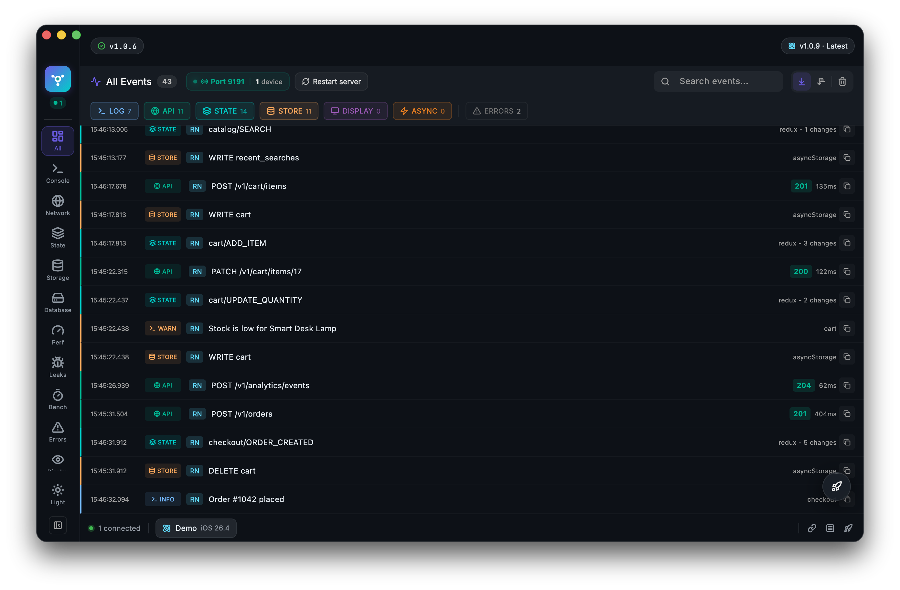
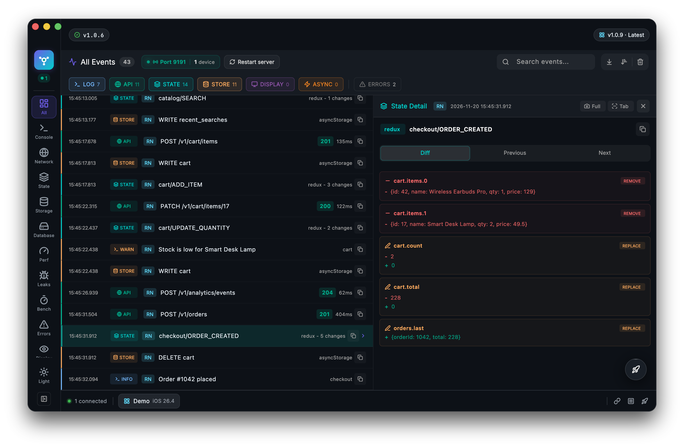
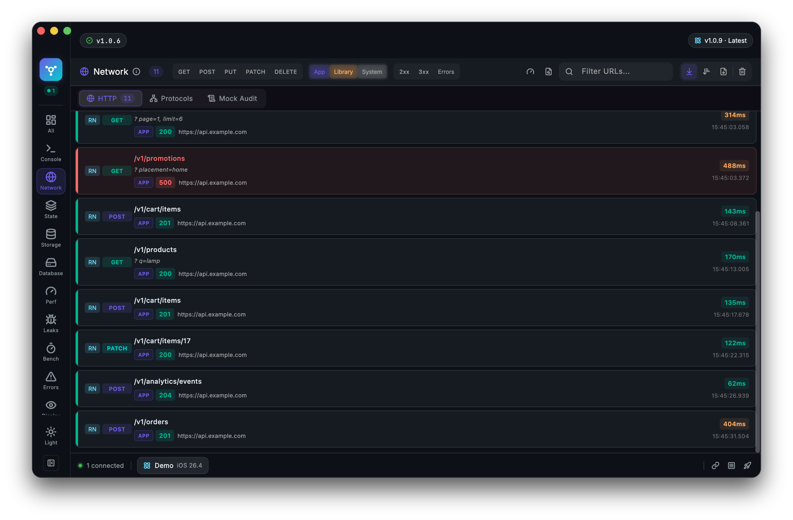
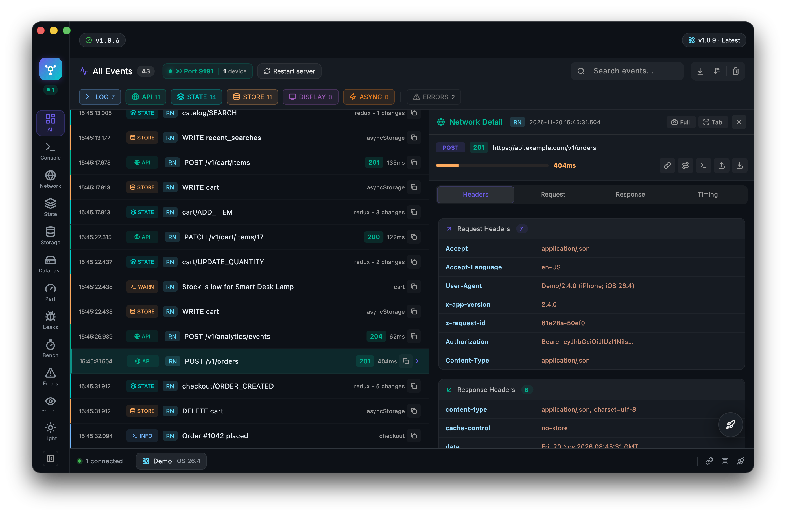
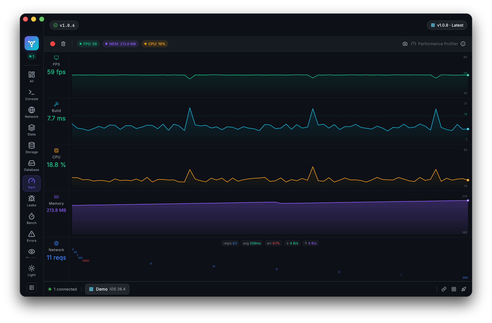
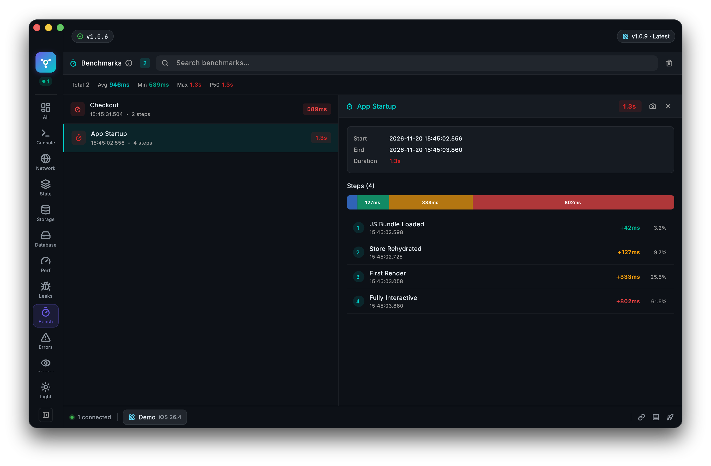
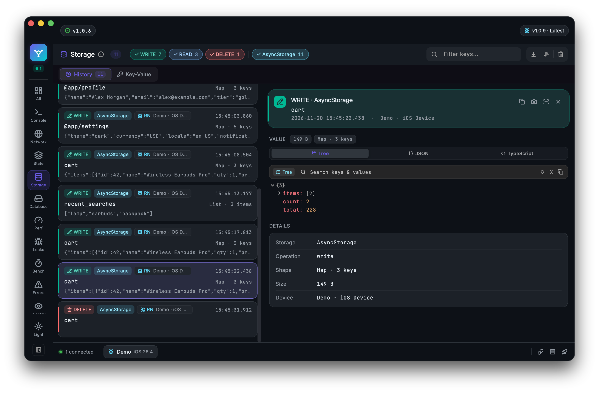

<div align="center">

# DevConnect Manage Kit

### A modern, cross-platform manage and debug tool — alternative to Reactotron and Flipper

**Debug Flutter, React Native & Android apps — network, state, logs, storage, database — all in one beautiful desktop tool.**

[](https://github.com/ridelinktechs/devconnect-manage-kit/releases)
[](client_sdks/devconnect_flutter/README.md)
[](client_sdks/devconnect-react-native/README.md)
[](client_sdks/devconnect-android/README.md)
[](LICENSE)

[Demo](#demo) · [Features](#features) · [Download](#download) · [Quick Start](#quick-start) · [Desktop Guide](#using-the-desktop-app) · [Mock Server](#mock-server) · [SDKs](#sdks) · [Support](#support-devconnect-manage-kit)

</div>

---

## Demo

<div align="center">

[](docs/demo/devconnect-tutorial.mp4)

**[▶ Watch the full walkthrough of every page (MP4, about 3 minutes)](docs/demo/devconnect-tutorial.mp4)**

</div>

---

## Why DevConnect Manage Kit?

If you've used **Reactotron**, **Flipper**, or **Flutter DevTools** — you know they're powerful but limited to one framework. DevConnect Manage Kit is a **single desktop app** that works with all of them.

|                        |          DevConnect Manage Kit           |  Reactotron   |    Flipper    | Flutter DevTools |
| ---------------------- | :--------------------------------------: | :-----------: | :-----------: | :--------------: |
| Flutter support        |                    ✅                    |      ❌       |   ⚠️ plugin   |        ✅        |
| React Native support   |                    ✅                    |      ✅       |      ✅       |        ❌        |
| Android Native support |                    ✅                    |      ❌       |      ✅       |        ❌        |
| Network inspector      |                    ✅                    |      ✅       |      ✅       |        ✅        |
| State debugging        | ✅ Redux/MobX/Zustand/BLoC/Riverpod/GetX | ✅ Redux/MobX |      ✅       |        ❌        |
| Log viewer             |                    ✅                    |      ✅       |      ✅       |        ✅        |
| Storage viewer         |                    ✅                    |      ✅       |      ✅       |        ❌        |
| Database browser       |                    ✅                    |      ❌       |      ✅       |        ❌        |
| Performance profiling  |          ✅ FPS/CPU/Memory/Jank          |      ❌       |      ❌       |        ✅        |
| Memory leak detection  |                    ✅                    |      ❌       |      ❌       |        ✅        |
| Benchmark timing       |                    ✅                    |      ✅       |      ❌       |        ✅        |
| Custom commands        |                    ✅                    |      ✅       |      ❌       |        ❌        |
| Multi-device           |                    ✅                    |      ❌       |      ✅       |        ❌        |
| Zero-config setup      |              ✅ auto-detect              |   ❌ manual   |      ⚠️       |        ⚠️        |
| macOS + Windows        |                    ✅                    |      ✅       | ⚠️ deprecated |        ✅        |
| Dark + Light theme     |                    ✅                    |      ✅       |      ✅       |        ✅        |
| Active maintenance     |                    ✅                    |    ⚠️ slow    | ❌ deprecated |        ✅        |

> **TL;DR** — One tool to replace Reactotron + Flipper + DevTools. Works with Flutter, React Native, and Android Native. Auto-detects everything.

---

## Features

- **Network Inspector** — HTTP request/response viewer with headers, body (tree + JSON), timing bar, copy as cURL, status badges
- **State Inspector** — Real-time state change timeline with before/after diff for Redux, MobX, Zustand, Jotai, Valtio, XState, BLoC, Riverpod, GetX, Provider, ViewModel, StateFlow, LiveData; snapshot, restore and dispatch actions from the desktop
- **Console / Logs** — Log viewer with level filters (debug/info/warn/error), search, tags, metadata, stack traces
- **Storage Viewer** — Browse and monitor SharedPreferences, AsyncStorage, Hive, MMKV, SecureStorage, DataStore; edit the live key-value store
- **Database Browser** — SQLite, Drift, Room, Isar table viewer with SQL query editor and table structure
- **Layout Inspector** — Capture the app's screen and element tree; inspect each element's bounds, box model and props
- **Error Inspector** — JS and native errors and crashes with stack traces
- **Display & Async Operations** — Watch values your app sends, and sagas, thunks and background jobs with their timing
- **History** — Sessions of devices that disconnected, with everything they sent
- **Performance Profiling** — Real-time FPS, CPU, memory usage charts with jank frame detection
- **Memory Leak Detection** — Detect undisposed controllers, streams, timers, growing collections with severity levels and stack traces
- **Benchmark** — Performance timing with step markers
- **Custom Commands** — Send commands from desktop to app and get results
- **Multi-Device** — Connect multiple apps simultaneously, per-device filtering
- **All Events** — Unified timeline of all events across features
- **Mock Server** — Push mock HTTP responses down to devices, audit every intercepted request with full URL/method/status/rule-name
- **Screenshot** — Full-content screenshot capture of any detail panel
- **ADB Reverse** — One-click USB connection for Android devices
- **Auto-detect** — SDK auto-discovers desktop IP, zero configuration needed
- **Dual Theme** — Dark and light mode

[](https://github.com/sponsors/ridelinktechs)

### Screenshots

| All Events                                     | State Inspector                                    |
| ---------------------------------------------- | -------------------------------------------------- |
|  |  |

| Network Inspector                                  | Network Detail                                         |
| -------------------------------------------------- | ------------------------------------------------------ |
|  |  |

| Performance Profiler                             | Benchmark                                    |
| ------------------------------------------------ | -------------------------------------------- |
|  |  |

| Storage Viewer                           |
| ---------------------------------------- |
|  |

---

## Download

| Platform | File                                              | Architecture   |
| -------- | ------------------------------------------------- | -------------- |
| macOS    | `DevConnectManageTool-macOS-v1.0.1-universal.dmg` | arm64 + x86_64 |
| Windows  | `DevConnectManageTool-Windows-v1.0.1.zip`         | x64            |

Download from [Releases](https://github.com/ridelinktechs/devconnect-manage-kit/releases).

---

## Quick Start

### Flutter — 2 lines

```dart
import 'package:devconnect_manage_kit/devconnect_manage_kit.dart';

void main() async {
  await DevConnect.initAndRunApp(
    appName: 'MyApp',
    runApp: () => runApp(const MyApp()),
  );
  // Done. Network + logs auto-captured.
}
```

### React Native — 1 line

```typescript
import { DevConnect } from "devconnect-manage-kit";

await DevConnect.init({ appName: "MyApp" });
// Done. fetch + XHR + console auto-captured.
```

### Android Native — 1 line

```kotlin
// Application.onCreate()
DevConnect.installForApp(
    context = this,
    appName = "MyApp",
    enabled = BuildConfig.DEBUG,
)
```

That's it. Open DevConnect Manage Tool desktop, run your app, and everything appears.

---

## Desktop App

### Build from source

```bash
git clone https://github.com/ridelinktechs/devconnect-manage-kit.git
cd devconnect
flutter pub get
dart run build_runner build --delete-conflicting-outputs
flutter build macos --release   # macOS
flutter build windows --release # Windows
# Output: build/macos/Build/Products/Release/DevConnectManageTool.app
```

### Features

- Console/Logs - real-time log viewer, level filters, search, clear
- Network Inspector - request/response, headers, body, timing, copy cURL, copy response
- State Inspector - state change timeline, before/after diff, snapshot + restore
- Storage Viewer - SharedPreferences, AsyncStorage, Hive, MMKV, SecureStorage
- Database Viewer - SQLite, Drift, Room, Isar with query editor
- Performance Profiling - real-time FPS, CPU, memory charts with jank detection
- Memory Leak Detection - severity-based leak viewer with stack traces and metadata
- Benchmark - performance timing with steps
- Custom Commands - send commands from desktop to app
- Layout Inspector - screen capture, element tree, bounds and props
- Error Inspector - JS and native errors with stack traces
- Display & Async - values your app sends, sagas and jobs with timing
- Mock Server - mock HTTP responses pushed to the device, with an audit
- History - sessions of devices that disconnected
- Device Panel - connected devices with platform badge, OS version
- ADB Reverse - one-click for Android USB
- Port Config - change WebSocket port in Settings
- Auto-detect Host - SDK auto-finds desktop IP
- Dual Theme - dark / light

---

## SDKs

Each SDK ships as its own package with a complete install + API guide. Pick yours:

### Flutter — `devconnect_manage_kit`

```yaml
# pubspec.yaml
dependencies:
  devconnect_manage_kit: ^1.0.6
```

- Network (dio, http, GraphQL, gRPC) · State (Riverpod, BLoC, GetX, Provider, ViewModel) · Storage (SharedPreferences, Hive, MMKV) · Database (Drift, Isar, SQLite) · Performance + Memory Leak Detection + Benchmark · Mock server

📖 **[Full Flutter SDK guide →](client_sdks/devconnect_flutter/README.md)**

### React Native — `devconnect-manage-kit`

```bash
npm install devconnect-manage-kit
# or
yarn add devconnect-manage-kit
```

- Network (fetch, XHR, axios, Apollo, urql, TanStack Query, SWR) · State (Redux, MobX, Zustand, Jotai, Valtio, XState) · Storage (AsyncStorage, MMKV) · Performance + Memory Leak Detection + Benchmark · Mock server

📖 **[Full React Native SDK guide →](client_sdks/devconnect-react-native/README.md)**

### Android — `io.github.buivietphi:devconnect-android`

```gradle
// app/build.gradle.kts
dependencies {
    implementation("io.github.buivietphi:devconnect-android:1.1.0")
}
```

- Network (OkHttp, Ktor, Volley) · State (ViewModel/StateFlow/LiveData) · Storage (SharedPreferences, DataStore, MMKV) · Database (Room) · Crash & ANR detection (native signal handler, pre-built in AAR) · Compose, GraphQL, gRPC, WebSocket inspector

> The native crash handler ships inside the AAR — no NDK setup required. Optional deps (OkHttp, lifecycle, kotlin-reflect…) are `compileOnly`; see [Android SDK README → Runtime dependencies](client_sdks/devconnect-android/README.md#runtime-dependencies).

📖 **[Full Android SDK guide →](client_sdks/devconnect-android/README.md)**

See [Architecture](#architecture) for protocol details.

---

## Real Device Connection

### Auto-detect (default)

SDK tries these addresses in order:

1. `localhost` (iOS simulator, macOS)
2. `10.0.2.2` (Android emulator)
3. `10.0.3.2` (Genymotion)
4. Scan local network subnet

### Manual IP

Check your desktop IP in **Settings** page (click to copy), then:

```dart
await DevConnect.init(appName: 'MyApp', host: '192.168.1.5');
```

### Android USB

In desktop **Settings > Android Device (USB)**, click **"Run ADB Reverse"**.

Or manually: `adb reverse tcp:9090 tcp:9090`

---

## Using the Desktop App

### Overview

Open DevConnect, run your app with the SDK — data appears automatically. The sidebar shows all features, the bottom bar shows connected devices.

### Pages

Every page in the sidebar, top to bottom:

| Page         | What it shows                                                                   | Key actions                                                                                                    |
| ------------ | ------------------------------------------------------------------------------- | -------------------------------------------------------------------------------------------------------------- |
| **All**      | One live timeline of every event: logs, requests, state, storage, display, async | Filter by type with the chips, search, click any event for its detail                                          |
| **Console**  | Logs with their level and tag                                                   | Filter by level (debug/info/warn/error), search, click a log to expand it                                      |
| **Network**  | HTTP requests and responses, other protocols, and the Mock Audit                | Filter by method, source (App/Library/System) or status; click a request for headers, params, body and timing |
| **State**    | Timeline of state changes, with **Controls**                                    | Click a change for its diff and previous/next state; snapshot, restore and dispatch from Controls             |
| **Storage**  | Every read, write and delete, and the live **Key-Value** store                  | Filter by operation and store; view a value as tree, JSON or TypeScript; edit keys in Key-Value               |
| **Database** | The app's SQLite databases and their tables                                     | Pick a table to preview it, run SQL, see the table's structure                                                 |
| **Perf**     | Live FPS, frame build time, CPU, memory and network charts                      | Hover for exact values, record or clear                                                                        |
| **Leaks**    | Memory leaks by severity (critical/warning/info)                                | Click a leak for its retained size, details and stack trace                                                    |
| **Bench**    | Benchmarks and their steps                                                      | Click one for each step's duration and share of the total                                                      |
| **Errors**   | Errors and crashes from JS and native code                                      | Filter by platform (JS/Native/Android/iOS); click one for its message, stack trace and details                |
| **Display**  | Values your app sends to watch: flags, the current user, anything               | Click one to see its value as a tree                                                                           |
| **Async**    | Sagas, thunks and background jobs                                               | See each start, resolve or reject with its duration; click one for details                                     |
| **Layout**   | The app's screen and element tree                                               | Capture, hover or click an element, inspect its bounds and props                                               |
| **Commands** | Commands your app registered                                                    | Pick one, add JSON arguments, **Run**, read the answer                                                         |
| **Mock**     | Mock HTTP rules                                                                 | **Add rule**, **Save changes**, **Push all** to the device                                                     |
| **History**  | Sessions of devices that disconnected                                           | Click a session to browse what it sent                                                                         |
| **Settings** | Server, devices, appearance, data, guides                                       | Change the port, theme, language and which tabs show                                                           |

### Pages keep their place

Switching pages doesn't reset them. Each page keeps its selection, open detail panel, scroll position, search text, SQL query and layout capture. A page you're not looking at pauses, then catches up with everything that arrived as soon as you come back.

### State controls

**State → Controls** drives the app's state from the desktop:

- **Subscriptions** — pin a path such as `auth.user.name` to watch its live value.
- **Snapshots** — **Take snapshot** saves the whole state; **Restore** sends it back to the app, e.g. to replay a bug.
- **Dispatch action** — send an action as JSON, such as `{"type": "cart/CLEAR"}`; the change it makes shows up in the timeline.

The app opts in with a few lines: [Flutter](client_sdks/devconnect_flutter/README.md#controls-from-the-desktop) · [React Native](client_sdks/devconnect-react-native/README.md#controls-from-the-desktop) · [Android](client_sdks/devconnect-android/README.md#controls-from-the-desktop)

### Storage: history and live store

- **History** lists every read, write and delete. Click one to see its value as a tree, as JSON or as a TypeScript type.
- **Key-Value** shows each registered store as it is now. Add, edit or delete a key, or clear the whole store; the app answers with the store's new contents.

Setup: [Flutter](client_sdks/devconnect_flutter/README.md#storage-editing) · [React Native](client_sdks/devconnect-react-native/README.md#storage-editing) · [Android](client_sdks/devconnect-android/README.md#storage-editing)

### Database

1. Pick a table on the left. It opens with its first 50 rows; filter the list to find a table fast.
2. Write SQL in the editor and click **Run**, or press <kbd>⌘</kbd> <kbd>↵</kbd> (<kbd>Ctrl</kbd> <kbd>Enter</kbd> on Windows).
3. Read the result in the grid: each column's type, the primary key, `NULL` values set apart. The status bar shows the row count, the time taken and the database. Double-click a cell to copy it.
4. Switch to **Structure** for the table's columns, types, primary key and nullability.

Queries run in the app on the device, and a result stops at 1,000 rows. Setup: [Flutter](client_sdks/devconnect_flutter/README.md#database-browser) · [React Native](client_sdks/devconnect-react-native/README.md#database-browser) · [Android](client_sdks/devconnect-android/README.md#database-browser)

### Layout Inspector

1. Open **Layout** and click **Capture**. The app sends its current screen and element tree.
2. Hover the screenshot to outline an element, click it to select it, or pick it in the **Element tree** (search it by name or value).
3. **Properties** shows the element's box (margin, padding, content), its position and size, and its props.
4. Zoom with the toolbar or the keyboard: <kbd>⌘</kbd> <kbd>+</kbd> and <kbd>⌘</kbd> <kbd>−</kbd>, <kbd>⌘</kbd> <kbd>0</kbd> actual size, <kbd>⌘</kbd> <kbd>1</kbd> fit, <kbd>⌘</kbd> <kbd>2</kbd> zoom to the selection (<kbd>Ctrl</kbd> instead of <kbd>⌘</kbd> on Windows). Hold <kbd>⌥</kbd> (<kbd>Alt</kbd>) while hovering to measure distances.

React Native needs a screenshot provider (`DevConnect.registerScreenshot`). Setup: [Flutter](client_sdks/devconnect_flutter/README.md#layout-inspector) · [React Native](client_sdks/devconnect-react-native/README.md#layout-inspector) · [Android](client_sdks/devconnect-android/README.md#layout-inspector)

### Custom commands

Your app registers commands with `DevConnect.registerCommand(name, handler)`. Open **Commands**, pick one, add arguments as a JSON object if it takes any, and click **Run**. The app's answer appears below, with the commands you ran before it.

Setup: [Flutter](client_sdks/devconnect_flutter/README.md#custom-commands) · [React Native](client_sdks/devconnect-react-native/README.md#custom-commands) · [Android](client_sdks/devconnect-android/README.md#custom-commands)

### Display, Async, Leaks and Errors

These pages fill in from the SDK:

| Page        | Fills in from                                                                                   |
| ----------- | ----------------------------------------------------------------------------------------------- |
| **Display** | `DevConnect.display(name, …)`: any value you want to watch, with a short preview                |
| **Async**   | `DevConnect.reportAsyncOperation(…)`: the start, resolve or reject of a saga, thunk or job      |
| **Leaks**   | The SDK's leak detector, or your own `DevConnect.reportMemoryLeak(…)`                           |
| **Errors**  | Uncaught errors and crashes, which every SDK captures by default                                |

### History

When a device disconnects and doesn't come back within 15 seconds, its session moves to **History** with the logs, requests, state changes and storage writes it sent. Click a session to browse them. A device that reconnects within 15 seconds counts as a reload, and once a device connects again (the same device, or from the same IP address) its old session leaves History.

### Mock Server

Replace real network responses with mock data for testing edge cases without touching the backend. The desktop pushes rules down; the SDK intercepts matching requests before they hit the network and audits every hit back to the desktop.

**Creating a rule**

1. Open the **Mock** tab
2. Click **+ Add rule**
3. Fill in:
   - **Rule name** — human-readable label (e.g. `Get user 404`)
   - **Method** — GET / POST / PUT / PATCH / DELETE
   - **URL pattern** — a regex found anywhere in the URL (e.g. `/api/users/\d+`)
   - **Status** — HTTP status code; pick a preset (200, 404, 500, ...) or type one
   - **Delay (ms)** — wait before answering; pick a preset or type one
   - **Response headers** — one per line, `key: value`
   - **Response body** — raw string or JSON (**Format** tidies JSON)
4. Optional **Limits**:
   - **Only on device IDs** — comma-separated; empty means every device the rules are pushed to
   - **Expires at** — ISO-8601 timestamp; the rule is ignored past this time
5. Click **Save changes**, then **Push all** to send the rules to the device. The device pill in the toolbar says whether it has them (`live`) or not (`not pushed`); **Clear device** takes them off again. To delete a rule, press and hold **Hold to delete**.

**On the device**

No code changes needed. The SDK's `MockServerInterceptor` (already installed alongside `dio` / `axios` / `okHttp` interceptors) listens for `server:mock_rules_update` and caches the rule list in memory. When a matching request fires, the interceptor returns the mocked response immediately — the real network stack is never touched.

**Auditing**

Every intercepted request emits `client:mocked_request` back to the desktop. **Network → Mock Audit** shows:

- Method + URL pattern that matched
- HTTP status returned
- Rule name (looked up locally by `ruleId`)
- Timestamp

Click any row for the full entry detail.

**Example**

| Field      | Value                       |
| ---------- | --------------------------- |
| Name       | Get user 404                |
| Method     | GET                         |
| URL        | `/api/users/999$`           |
| Status     | 404                         |
| Body       | `{"error":"not found"}`     |
| Delay      | 500                         |

In the app, calling `GET /api/users/999` returns 404 instantly with the mock body — the desktop audit row appears the moment the SDK intercepts it.

### Toolbar Controls

Every list page has these controls in the toolbar:

- **Filter chips** — Click to filter (single-select for methods, multi-select for types)
- **Search** — Filter by text content
- **Auto-scroll** — Pin to newest entries (click to toggle)
- **Sort direction** — Newest first or oldest first
- **Clear** — Delete all entries (trash icon)

### Multi-Device

When multiple apps are connected, use the device selector in the bottom bar to filter by device or view "All Devices".

### Settings

- **Connection** — Start, stop or restart the WebSocket server and change its port (default: 9090); your desktop's IP addresses (click to copy); one-click ADB reverse for Android over USB
- **Devices** — Connected devices, and every device that has connected before
- **Appearance** — Dark/light theme, language, auto-scroll, smooth scrolling, and **Tab Visibility** to hide tabs you don't need
- **Display & data** — Detail view defaults, how much data to keep, what All Events shows
- **Guides** — Setup snippets for each platform, with this desktop's address filled in, and tips

---

## Production Safety

All SDKs are **disabled by default in production builds** — zero runtime overhead.

| SDK          | Guard               | Behavior in production                             |
| ------------ | ------------------- | -------------------------------------------------- |
| Flutter      | `kDebugMode`        | Returns immediately, no WebSocket, no interceptors |
| React Native | `__DEV__`           | Creates dummy instance, all methods are no-ops     |
| Android      | `BuildConfig.DEBUG` | Returns immediately, nothing initialized           |

You can also manually disable:

```dart
DevConnect.init(appName: 'MyApp', enabled: false);  // Flutter
```

```typescript
DevConnect.init({ appName: "MyApp", enabled: false }); // React Native
```

```kotlin
DevConnect.init(context = this, appName = "MyApp", enabled = false)  // Android
```

**No need to remove SDK code for release builds.** The compiler strips dead code paths automatically.

---

## Architecture

- **Desktop**: Flutter Desktop (macOS/Windows) + Riverpod + go_router + Freezed
- **Protocol**: JSON over WebSocket (default port 9090)
- **SDKs**: Flutter (pub.dev), React Native (npm), Android (Maven Central — AAR)

## Contributing

DevConnect Manage Kit is **open source** under the [MIT License](LICENSE). Contributions are welcome!

### How to contribute

1. Fork the repo
2. Create your branch (`git checkout -b feature/my-feature`)
3. Commit changes (`git commit -m 'feat: add my feature'`)
4. Push (`git push origin feature/my-feature`)
5. Open a Pull Request

See [CONTRIBUTING.md](CONTRIBUTING.md) for development setup and guidelines.

---

## Related Projects & Alternatives

Looking for mobile debugging tools? Here's how DevConnect compares:

- **[Reactotron](https://github.com/infinitered/reactotron)** — Great for React Native + Redux, but no Flutter/Android support. DevConnect covers all three.
- **[Flipper](https://github.com/facebook/flipper)** — Facebook's extensible debugger, now deprecated. DevConnect is actively maintained.
- **[Flutter DevTools](https://docs.flutter.dev/tools/devtools)** — Official Flutter debugging, but no React Native or Android Native. DevConnect adds cross-platform support.

> Searching for: _reactotron alternative_, _flipper replacement_, _flutter debugging tool_, _react native debugger_, _android debug inspector_, _mobile app debugger_, _cross-platform debugging_, _network inspector_, _state debugger_, _redux devtools mobile_? DevConnect is built for you.

---

## Support DevConnect Manage Kit

DevConnect Manage Kit is free and open source. If it saves you debugging time, consider supporting development:

<div align="center">

[](https://github.com/sponsors/ridelinktechs)
[](https://ko-fi.com/buivietphi)
[](https://paypal.me/buivietphi)

</div>

---

## License

**MIT License** — Everything in this repository (desktop app + all SDKs) is free
for any use, including commercial. Use it, modify it, ship it — no restrictions.

```
MIT License

Copyright (c) 2026 MTI ridelinktechs

Permission is hereby granted, free of charge, to any person obtaining a copy
of this software and associated documentation files (the "Software"), to deal
in the Software without restriction, including without limitation the rights
to use, copy, modify, merge, publish, distribute, sublicense, and/or sell
copies of the Software, and to permit persons to whom the Software is
furnished to do so, subject to the following conditions:

The above copyright notice and this permission notice shall be included in all
copies or substantial portions of the Software.

THE SOFTWARE IS PROVIDED "AS IS", WITHOUT WARRANTY OF ANY KIND.
```

See [LICENSE](LICENSE) and [client_sdks/*/LICENSE](client_sdks/) for the full text.

---

<div align="center">

**DevConnect Manage Tool** — Debug Flutter, React Native & Android apps from one desktop tool.

_A modern alternative to Reactotron, Flipper, and platform-specific debugging tools._

</div>
